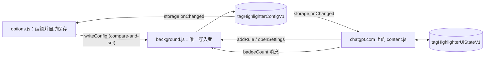

# 架构

[English](Architecture)

## 脚本

扩展是写在 IIFE 中的纯 JavaScript，没有依赖，也没有打包工具。

| 脚本 | 职责 |
|---|---|
| `background.js` | 唯一写入设置的脚本。所有写入都在同一条 Promise 链上执行：安装/启动时的初始化与迁移、设置页发来的比较并设置（compare-and-set）`writeConfig`，以及快速标签菜单发来的 `addRule`（追加标签）。打开或聚焦浮动设置窗口（`openSettings` 消息和工具栏图标），并根据 `badgeCount` 消息设置图标角标（全局一个角标）。 |
| `options.js` | 渲染和编辑规则与选项；以 `{base, next}` 把完整配置发给 `background.js`，同一时间只有一次保存在进行。只有没有未保存修改时才会重新渲染外部修改，否则显示带 **Reload** 的冲突横幅。自己从不写存储。 |
| `content.js` | 在 ChatGPT 上运行；编译配置、给侧边栏加样式、显示横幅，处理筛选、设置齿轮、快速标签（重命名与撤销）、快捷键、轮次剪裁和长对话渲染。 |

## 存储

- `tagHighlighterConfigV1`：规则和选项。优先从 `storage.sync` 读取，回退到 `storage.local`。
- `tagHighlighterUiStateV1`：选中的筛选标签，仅保存在 `storage.local`，并有 400 ms 防抖，因此不会与设置页的写入或同步配额冲突。

设置页的写入只有在存储中的值仍等于它所基于的 `base` 时才会生效；否则不写入任何内容，设置页显示冲突横幅。两个窗口中的并发修改永远不会合并：后保存的一方必须 Reload。`addRule` 总是追加到最新的存储值上。新增配置字段必须在三个脚本中都有安全的默认值。颜色始终以 `#rrggbb` 保存。

快速标签的重命名请求由 `content.js` 直接发往 ChatGPT（先 `GET`，再 `PATCH /backend-api/conversation/{id}`，内容为 `{"title"}`），不经过 `background.js`。`background.js` 只负责排队：通过 `cth-chat-lock:<id>` 端口，让各标签页对同一会话一次只进行一个重命名。重命名结束时释放；如果标签页在 PATCH 发出之前关闭，则立即释放。如果已发出的 PATCH 得不到 ChatGPT 的答复（标签页关闭或请求失败），该会话会一直被锁定，没有超时，直到用户选择 **Tag anyway**（仍会先读取当前标题）或浏览器会话结束。待确认的重命名记录保存在 `storage.session` 中；如果无法读取或写入该记录，则不会发送任何重命名。见 [隐私](Privacy-zh-CN)。

## ChatGPT 页面钩子

ChatGPT 会不打招呼地改动页面。内容脚本依赖：

- **侧边栏：** `#history` → `a[data-sidebar-item="true"]`，标题在 `.truncate span[dir="auto"]` 中。打开的会话带有空的 `data-active` 属性；`data-active="false"` 不算选中。
- **输入框：** `#prompt-textarea` 位于 `form[data-type="unified-composer"]` 中，旧布局回退到 `div.bg-token-bg-primary`。横幅以它为定位基准。
- **消息：** `[data-testid="conversation-turn-N"]`，现在是 `<section>`（以前是 `<article>`）。真正的滚动容器是 `<main>` 之上的一个 `overflow-y: auto` 元素。
- **ChatGPT 的"滚动到底部"按钮：** 一个没有标签、`aria-hidden` 的按钮，位于 class 中含 `data-scroll-from-end` 的容器内。

ChatGPT 改版后，先根据检查到的页面结构（绝不使用真实标题或消息）更新测试夹具，写一个会失败的测试，再修复。见 [测试](Testing-zh-CN)。

## 生命周期

- DOM 操作通过 `requestAnimationFrame` 调度器批量处理，`WeakMap` 标题缓存会跳过未变化的会话。
- 侧边栏观察器监听 `#history` 中的新会话、标题文字和选中变化。页面级观察器在 `#history` 被替换、移除或延迟挂载时重新绑定，包括首次安装时设置晚于页面到达的情况。
- 消息观察器只在开启轮次剪裁或长对话渲染时运行。
- 横幅把"需要显示"（打开的会话命中规则）和"已显示"（输入框可测量）分开跟踪，因此 ChatGPT 重新挂载输入框后能恢复。
- 内容脚本运行在隔离环境中，看不到 ChatGPT 自己的 `history.pushState` 调用，所以依赖 DOM 观察器。扫描时不能写入侧边栏观察器监听的属性，以免形成变更循环。
