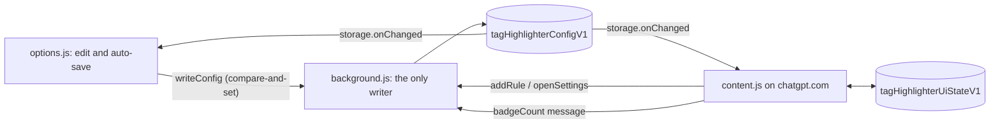

# Architecture

[简体中文](Architecture-zh-CN)

## Scripts

The extension is plain JavaScript in IIFEs, with no dependencies or bundler.

| Script | Role |
|---|---|
| `background.js` | The only script that writes the settings. One promise chain runs every write: seeding and migration on install/startup, compare-and-set `writeConfig` from the options page, and `addRule` (append a tag) from the quick tag menu. Opens or focuses the floating settings window (`openSettings` messages and the toolbar icon), and sets the icon badge from `badgeCount` messages (one global badge). |
| `options.js` | Renders and edits rules and options; sends the whole config to `background.js` as `{base, next}` with one save in flight. Re-renders outside changes only when it has no unsaved edits; otherwise shows a conflict banner with **Reload**. Never writes storage itself. |
| `content.js` | Runs on ChatGPT; compiles the config, styles the sidebar, shows the banner, handles filters, the settings gear, quick tag (rename + Undo), shortcuts, pruning and long-chat rendering. |

## Storage

- `tagHighlighterConfigV1`: rules and options. Read from `storage.sync`, falling back to `storage.local`.
- `tagHighlighterUiStateV1`: selected filter pills, in `storage.local` only, saved with a 400 ms debounce so it never competes with options-page writes or sync quotas.

A write from the options page is applied only if the stored value still equals the `base` it was built from; otherwise nothing is written and the page shows its conflict banner. Concurrent edits in two windows are never merged: the second one must Reload. `addRule` always appends to the freshest stored value. A new config field must default safely in all three scripts. Colors are always saved as `#rrggbb`.

Quick tag renames go straight from `content.js` to ChatGPT (`GET` then `PATCH /backend-api/conversation/{id}` with `{"title"}`), not through `background.js`. `background.js` only queues them: one rename per chat at a time across tabs, through a `cth-chat-lock:<id>` port. It is released when the rename ends, or at once if the tab closes before the PATCH is sent. If ChatGPT's answer to a sent PATCH is lost (the tab closed or the request failed), the chat stays blocked, with no expiry, until the user chooses **Tag anyway** (which still reads the current title first) or the browser session ends. The pending-rename record lives in `storage.session`; if it can't be read or written, no rename is sent. See [Privacy](Privacy).

## ChatGPT page hooks

ChatGPT changes its page without notice, so the content script hooks only a few stable attributes and keeps a fallback for the older layout:

| Part | Current layout | Older layout |
|---|---|---|
| Sidebar chats | `#app-shell-sidebar [data-app-action-sidebar-scroll]` → `a[data-interactive-row-link="true"][href^="/c/"]`, title in `[data-thread-title="true"]`; the open chat has `aria-current="page"` | `#history` → `a[data-sidebar-item="true"]`, title in `.truncate`; the open chat has `data-active` (not `"false"`) |
| Message box (banner anchor) | `form[data-chatgpt-composer]` with a `[contenteditable="true"][data-composer-markdown]` editor | `#prompt-textarea` inside `form[data-type="unified-composer"]` |
| Turns | top-level `div[data-turn-key]`, one per user/assistant exchange | `[data-testid="conversation-turn-N"]`, one per message |
| Scroll-to-bottom button | `button[class~="group/scroll-to-bottom"]` | an unlabelled, `aria-hidden` button inside a `data-scroll-from-end` wrapper |
| Theme | `<html data-theme="light|dark">` | `light`/`dark` class on `<html>` |

The quick tag button is one fixed element on the page, placed beside the hovered row. It sits one stacking level above the sidebar, so the sidebar can't cover it, but below any ChatGPT panel or menu stacked above the sidebar.

## Long chats

**Why:** in a long conversation the browser keeps styling and laying out every message, even far off-screen, so resizing, theme changes and scrolling get slow.

**How:** with "Speed up long chats" on and at least 20 turn containers, every container except the newest 4 gets `content-visibility: auto`, so the browser skips it until it nears the screen. Each keeps its measured height as `contain-intrinsic-block-size`, so the scrollbar doesn't jump. Nothing is removed: scrolling, Find and selection keep working, and turning the option off restores normal rendering at once.

**Max chat turns** is the destructive alternative: it removes older containers from the page (never your account) until reload, keeping or removing whole exchanges, never half of one.

## Lifecycle

- DOM work is batched through `requestAnimationFrame` schedulers, and a `WeakMap` cache skips chats whose title and link haven't changed.
- A sidebar observer watches the chat list for new chats, title text and selection changes. A page-level observer rebinds when ChatGPT replaces, removes or late-mounts the sidebar, and restores missing filter controls.
- The message observer only runs while pruning or long-chat rendering is on.
- The banner tracks "wanted" (the open chat matches) separately from "shown" (a message box is measurable), so it recovers when ChatGPT re-mounts the message box.
- The content script runs in an isolated world and can't see ChatGPT's own `history.pushState` calls, so it relies on DOM observers. Scans never write attributes the sidebar observer watches, to avoid mutation loops.
