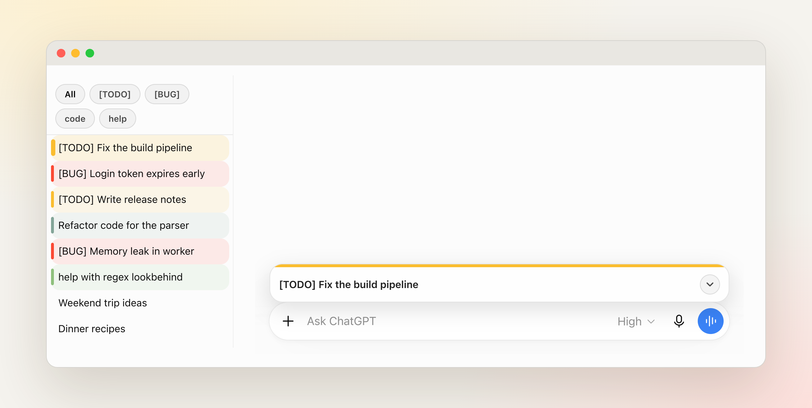

# ChatGPT Tag Highlighter Wiki

[English](Home)

ChatGPT Tag Highlighter 根据 `[TODO]`、`[BUG]` 这样的标题标签给 ChatGPT 侧边栏会话上色，提供标签筛选，并让超长对话保持流畅。
**从 [使用](Usage-zh-CN) 开始**，安装扩展并给第一批会话加标签。

### 功能

- [使用](Usage-zh-CN) — 安装、给会话加标签、筛选侧边栏、使用横幅和快捷键
- [设置](Configuration-zh-CN) — 标签规则、通用选项、规则测试器、导入与导出
- [隐私](Privacy-zh-CN) — 扩展读取和保存了什么，以及原因

### 工作原理

- [架构](Architecture-zh-CN) — 脚本、存储、ChatGPT 页面钩子、长对话渲染，以及这样设计的原因

构建、测试或参与贡献，请见[贡献指南](https://github.com/D0n9X1n/chatgpt-tag-highlighter/blob/main/.github/CONTRIBUTING.md)。
