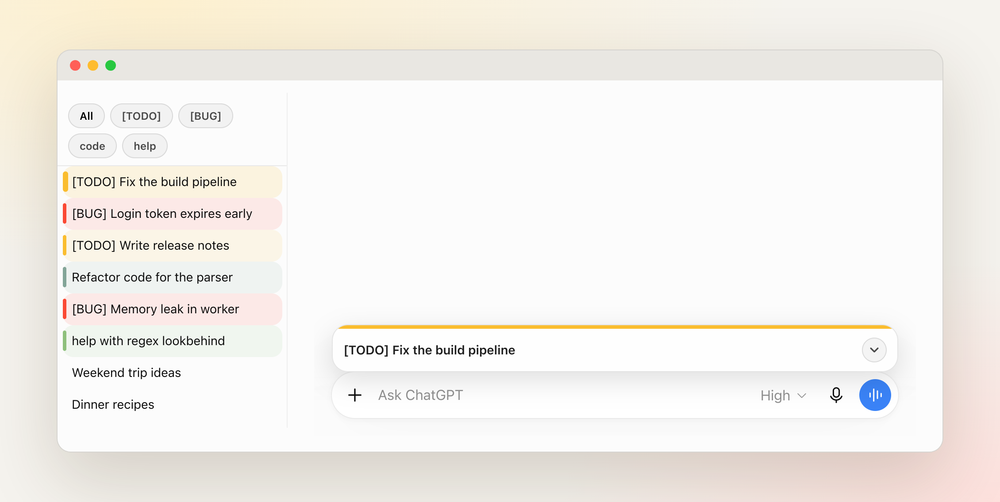

# ChatGPT Tag Highlighter Wiki

[简体中文](Home-zh-CN)

ChatGPT Tag Highlighter color-codes ChatGPT sidebar chats by title tags such as `[TODO]` and `[BUG]`, adds tag filters, and keeps long conversations fast.
**Start with [Usage](Usage)** to install it and tag your first chats.

### What it does

- [Usage](Usage) — install, tag chats, filter the sidebar, use the banner and shortcuts
- [Configuration](Configuration) — tag rules, general options, rule tester, import and export
- [Privacy](Privacy) — what the extension reads and stores, and why

### How it works

- [Architecture](Architecture) — scripts, storage, ChatGPT page hooks, long-chat rendering, and why they are built that way

To build, test or contribute, see the [Contributing guide](https://github.com/D0n9X1n/chatgpt-tag-highlighter/blob/main/.github/CONTRIBUTING.md).
