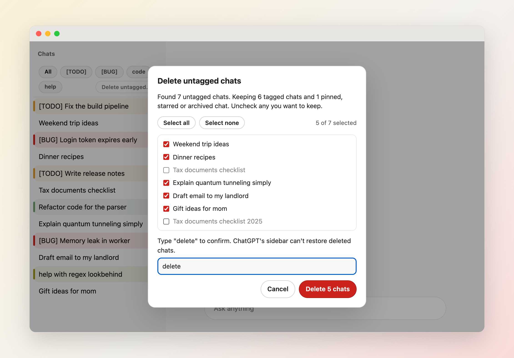

# 使用

[English](Usage)

## 安装

- **Chrome、Edge、Brave、Arc：** 从 [Chrome 应用商店](https://chromewebstore.google.com/detail/chatgpt-tag-highlighter/lplghggkggkbkkakjabafjenjlekogbm) 安装。
- **Firefox：** 从 [Firefox 附加组件](https://addons.mozilla.org/firefox/addon/chatgpt-tag-highlighter/) 安装。
- **本地构建：** 运行 `./publish.sh --version 0.0.99`，然后在 `chrome://extensions` 用 **Load unpacked** 加载 `dist/chrome/`，或在 `about:debugging` 用 **Load Temporary Add-on** 加载 `dist/firefox/manifest.json`。`src/` 中没有 `manifest.json`，不能直接加载。参见 [开发与发布](Development-and-Release-zh-CN)。

## 给会话加标签

在 ChatGPT 中把会话改名，让标题以标签开头，例如 `[TODO] 修复构建流水线` 或 `[BUG] 登录令牌提前过期`。安装时已自带四条规则：**[TODO]**（黄）、**[BUG]**（红）、**code**（蓝）、**help**（绿）。可在 [设置](Configuration-zh-CN) 中修改。

带标签的会话会有彩色左侧标柱和背景；当前打开的带标签会话显示柔和的标签色背景、细的标签色内描边和更宽的标柱；打开的无标签会话显示中性高亮和空心标柱，既能看出它已打开，也能看出它没有标签，且不会被淡化。匹配区分大小写，`startsWith` 规则要求标签位于标题最开头。

## 筛选侧边栏

当至少有两条规则没有设为 Hide 时，会话列表上方会出现标签按钮。点击一个或多个标签按钮，只显示这些标签的会话（命中任意一个选中标签即显示）。**All** 会清除选择。选择在刷新后保留，并在多个 ChatGPT 标签页之间共享。

## 删除无标签会话

默认关闭。在 [设置](Configuration-zh-CN) 中开启 **Show “Delete untagged chats” button**，然后点击筛选栏末尾的 **Delete untagged…**。即使规则太少、不显示标签按钮，筛选栏也会为这个按钮显示出来。

1. 扩展向 ChatGPT 获取完整的会话列表（不只是侧边栏已加载的部分），列出所有标题不匹配任何规则的会话。此时还不会删除任何内容。
2. 置顶、加星和已归档的会话会保留，所有命中规则的会话（包括被规则隐藏的）也会保留。没有标题的会话算作无标签。
3. 列表中的会话默认全部勾选。取消勾选想保留的会话，或使用 **Select all** / **Select none**；计数会显示已选数量。只有勾选的会话会被删除。
4. 输入 `delete` 并确认。删除前会再检查一次列表，预览之后被你加标签、置顶、加星、归档或删除的会话会被跳过。随后会话会逐个删除，使用的请求与 ChatGPT 自带的 **Delete** 相同，删除后立即从侧边栏消失。**Stop** 会在当前会话删除完后停止，遇到第一个错误也会停止。
5. **Reload page** 会刷新 ChatGPT 自己的会话列表。

ChatGPT 侧边栏无法恢复已删除的会话，请在确认前检查勾选的会话。此功能依赖 ChatGPT 未公开的网页接口，这些接口可能随时变化。项目（Projects）中的会话不在范围内。

## 标签横幅

当打开的会话命中一条开启了 **Overlay** 的规则时，输入框上方的横幅会显示它的标签颜色和标题。点击横幅会跳到最新消息，输入框保持焦点。横幅显示期间，ChatGPT 自带的"滚动到底部"按钮会被隐藏，避免出现两个；在无标签会话中不会动 ChatGPT 的按钮。

## 角标

扩展图标上显示已加载的侧边栏会话中、带标签且未被规则隐藏的数量。可在 [设置](Configuration-zh-CN) 中关闭。

## 快速标签

把鼠标悬停在侧边栏的会话上或让它获得焦点，点击 ChatGPT 自带 `⋯` 菜单旁出现的标签按钮；或按 `Alt+T`（macOS 上为 `Option+T`）给当前聚焦的会话加标签，没有聚焦的会话时作用于当前打开的会话。

- 菜单按规则顺序列出你的 `startsWith` 规则及其颜色。会话当前的标签会打勾，再次选择它不会有任何改动。
- 选择另一个标签会在 ChatGPT 上重命名会话：替换当前的前缀标签（取最长的匹配）及其后的空格，例如 `[TODO] 修复构建` 变成 `[BUG] 修复构建`。`includes` 规则不会被去掉。
- **Remove tag**（仅对带标签的会话显示）会去掉前缀标签。
- **New tag…** 会变成一个输入框。输入标签（1–40 个字符）并按 Enter：会新增一条 `startsWith` 规则，使用下一个未被占用的预置颜色，并应用到该会话。如果标签已存在，就沿用那条规则。按 Escape 回到菜单。
- 每次重命名（包括 Undo）之前，扩展都会先在 ChatGPT 上检查会话的当前标题；如果标题不同或无法检查，则不做任何修改。在这个浏览器的各个标签页中，扩展对同一会话的重命名会依次执行。ChatGPT 的 API 不支持条件写入，因此在 ChatGPT 自身或另一台设备上同时进行的重命名仍可能与之冲突（尽力而为）。
- 扩展更新或重新加载后，已打开的 ChatGPT 标签页会显示 **Reload this ChatGPT tab to tag chats.**，在你刷新之前不会做任何修改。如果重命名请求已发出但 ChatGPT 没有响应，会显示 **Not sure the rename finished. Reload to check.**
- 重命名以这种方式中断，或在保存过程中关闭了它所在的标签页之后，扩展无法确定 ChatGPT 是否已应用该重命名。此后给该会话加标签会显示 **An earlier rename of this chat didn't confirm. Reload ChatGPT to check the title.** 和 **Tag anyway** 按钮。你可以刷新页面查看真实标题，或点击 **Tag anyway**：扩展仍会先在 ChatGPT 上检查会话的当前标题，如果不同则不做任何修改。这种锁定会一直保持，直到你选择 **Tag anyway** 或关闭浏览器。
- 重命名后，提示条会显示 **Undo** 6 秒（鼠标悬停或聚焦时会一直保留）。Undo 会恢复原标题，除非该会话在此期间又被改了名（无论是在这里、另一个标签页还是另一台设备上）。
- 如果菜单打开期间标题已经变化，或 ChatGPT 拒绝了重命名，会弹出错误提示说明原因，且不做任何修改。

菜单可完全用键盘操作：方向键移动，Home/End 跳到首尾，Enter 或 Space 选择，Escape 关闭并回到按钮，Tab 关闭。重命名使用的请求与 ChatGPT 自带的 **Rename** 相同，见 [隐私](Privacy-zh-CN)。可在 [设置](Configuration-zh-CN) 中通过 **Show quick tag button** 关闭这个按钮。

## 设置窗口

筛选栏末尾的齿轮按钮和扩展的工具栏图标会在一个浮动小窗口中打开设置。如果设置窗口已经打开，会把它切到前面，而不是再开一个。如果浏览器无法打开弹出窗口，则打开普通的选项页。只要至少有一条规则，筛选栏就会显示，因此齿轮按钮始终可用；即使没有任何规则，工具栏图标也能用。

## 键盘快捷键

| 按键 | 作用 |
|---|---|
| `Alt+T`（macOS 上为 `Option+T`） | 为聚焦的会话（或当前打开的会话）打开快速标签菜单 |
| `Alt+H`（macOS 上为 `Option+H`） | 显示/隐藏被 Hide 规则隐藏的会话 |
| `Alt+F` | 聚焦筛选栏 |
| `Enter` 或 `Space` | 切换当前聚焦的标签按钮 |
