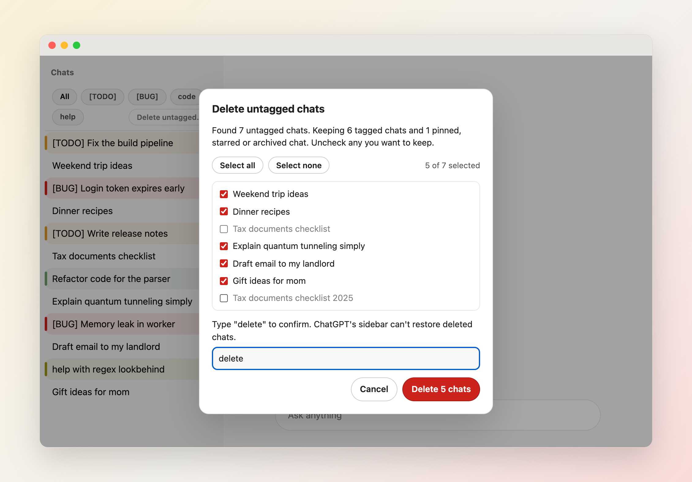

# Usage

[简体中文](Usage-zh-CN)

## Install

- **Chrome, Edge, Brave, Arc:** install from the [Chrome Web Store](https://chromewebstore.google.com/detail/chatgpt-tag-highlighter/lplghggkggkbkkakjabafjenjlekogbm).
- **Firefox:** install from [Firefox Add-ons](https://addons.mozilla.org/firefox/addon/chatgpt-tag-highlighter/).
- **Local build:** run `./publish.sh --version 0.0.99`, then load `dist/chrome/` with **Load unpacked** in `chrome://extensions`, or `dist/firefox/manifest.json` with **Load Temporary Add-on** in `about:debugging`. `src/` has no `manifest.json`, so it can't be loaded directly. See [Development and Release](Development-and-Release).

## Tag your chats

Rename a chat in ChatGPT so its title starts with a tag, for example `[TODO] Fix the build pipeline` or `[BUG] Login token expires early`. Four starter rules are set up on install: **[TODO]** (yellow), **[BUG]** (red), **code** (blue) and **help** (green). Change them in [Configuration](Configuration).

Tagged chats get a colored left stripe and background. The open tagged chat gets a soft tag-colored fill, a thin tag-colored outline and a wider stripe. An open untagged chat gets a neutral highlight with a hollow stripe, so you can see it's open and has no tag. It stays undimmed. Matching is case-sensitive, and `startsWith` rules need the tag at the very start of the title.

## Filter the sidebar

When at least two rules are not set to Hide, pills appear above the chat list. Click one or more tag pills to show only those chats (a chat shows if it matches any selected tag). **All** clears the selection. The selection survives a reload and is shared across ChatGPT tabs.

## Delete untagged chats

Off by default. Turn on **Show “Delete untagged chats” button** in [Configuration](Configuration), then click **Delete untagged…** at the end of the filter bar. The bar also appears for this button when there are too few rules for pills.

1. The extension asks ChatGPT for your whole chat list, not just the chats loaded in the sidebar, and lists every chat whose title matches no rule. Nothing is deleted yet.
2. Pinned, starred and archived chats are kept, and so is every chat that matches a rule, including rule-hidden ones. Untitled chats count as untagged.
3. Every listed chat starts checked. Uncheck the ones you want to keep, or use **Select all** / **Select none**; the count shows how many are selected. Only checked chats are deleted.
4. Type `delete` and confirm. The list is checked again first, and any chat you tagged, pinned, starred, archived or deleted since the preview is skipped. Chats are then deleted one at a time with the same request ChatGPT's own **Delete** sends, and disappear from the sidebar as they go. **Stop** halts after the current chat, and the first error stops the run.
5. **Reload page** refreshes ChatGPT's own list.

ChatGPT's sidebar can't restore deleted chats, so check the selection before you confirm. The feature relies on ChatGPT's private web endpoints, which can change without notice. Chats inside Projects aren't covered.

## The tag banner

When the open chat matches a rule with **Overlay** on, a banner above the message box shows its tag color and title. Click it to jump to the latest message; the message box keeps focus. While the banner is shown, ChatGPT's own scroll-to-bottom button is hidden so there's only one. In untagged chats ChatGPT's button is left alone.

## Badge

The extension icon shows how many loaded sidebar chats are tagged and not hidden by a rule. Turn it off in [Configuration](Configuration).

## Quick tag

Hover or focus a chat in the sidebar and click the tag button that appears next to ChatGPT's own `⋯` menu, or press `Alt+T` (`Option+T` on macOS) to tag the focused chat, or the open chat when no chat is focused.

- The menu lists your `startsWith` rules in rule order, with their colors. The chat's current tag is checked; picking it again changes nothing.
- Picking another tag renames the chat on ChatGPT: the current prefix tag (the longest matching one) and the spaces after it are replaced, so `[TODO] Fix build` becomes `[BUG] Fix build`. `includes` rules are never stripped.
- **Remove tag** (shown only for tagged chats) removes the prefix tag.
- **New tag…** turns into a text box. Type a tag (1–40 characters) and press Enter: a `startsWith` rule is added with the next unused palette color and applied to the chat. If the tag already exists, that rule is reused. Escape goes back to the menu.
- Right before every rename, including Undo, the extension checks the chat's current title on ChatGPT and changes nothing if it differs or can't be checked. Its own renames of the same chat run one at a time across tabs in this browser. A rename made in ChatGPT itself or on another device at the same moment can still race (best-effort).
- After the extension is updated or reloaded, open ChatGPT tabs show **Reload this ChatGPT tab to tag chats.** and change nothing until you reload them. If ChatGPT doesn't answer a rename it was sent, you see **Not sure the rename finished. Reload to check.**
- After a rename is interrupted that way, or by closing its tab while it was being saved, the extension waits up to a minute before renaming that chat again, so tagging it meanwhile may show **Still saving this chat — try again**.
- After a rename, a toast shows **Undo** for 6 seconds (longer while you hover or focus it). Undo restores the old title, unless the chat was renamed again in the meantime: here, in another tab or on another device.
- If the title changed while the menu was open, or ChatGPT refuses the rename, an error toast explains it and nothing changes.

The menu works from the keyboard: arrow keys move, Home/End jump, Enter or Space picks, Escape closes and returns to the button, Tab closes. Renaming uses the same request ChatGPT's own **Rename** sends; see [Privacy](Privacy). Turn the button off with **Show quick tag button** in [Configuration](Configuration).

## Settings window

The gear at the end of the filter bar and the extension's toolbar icon open the settings in a small floating window. If it is already open, it is brought to the front instead of opening a second one. If the browser can't open a popup window, the usual options page opens. The filter bar shows whenever at least one rule exists, so the gear is always reachable; the toolbar icon works even with no rules.

## Keyboard shortcuts

| Keys | Action |
|---|---|
| `Alt+T` (`Option+T` on macOS) | Open the quick tag menu for the focused chat, or the open chat |
| `Alt+H` (`Option+H` on macOS) | Show or hide chats hidden by a Hide rule |
| `Alt+F` | Move focus to the filter bar |
| `Enter` or `Space` | Toggle the focused filter pill |
